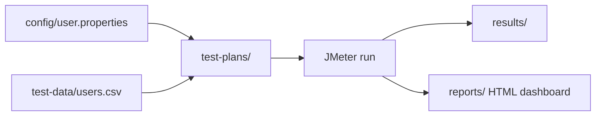

# JMeter Performance Testing

JMeter load, stress and spike test plans for a public demo API. Built as hands-on practice for junior / mid level performance testing work.

Target: https://jsonplaceholder.typicode.com (a free public fake API, no real data is created).

## Folder tree

```
jmeter-performance-testing/
├── ARCHITECTURE.md            # folder tree, data flow, how to add a plan
├── README.md                  # this file
├── .env.example               # optional local overrides (no secrets in this repo)
├── .gitignore
├── config/
│   └── user.properties        # host, protocol, port, timeouts, thread counts
├── docs/
│   ├── SETUP.md               # install JMeter, run plans, property overrides
│   └── TESTING.md             # what is tested, how to read HTML reports
├── test-data/
│   └── users.csv              # 10 rows of userId, postId, title
├── test-plans/
│   ├── load-test.jmx          # 10 threads, 10 s ramp-up, 5 loops
│   ├── stress-test.jmx        # 50 threads, 30 s ramp-up, 10 loops
│   └── spike-test.jmx         # 100 threads, 5 s ramp-up, 45 s duration, loops until duration ends
├── scripts/
│   └── run-jmeter.sh          # headless run + HTML dashboard for load|stress|spike
├── results/                   # git-ignored: .jtl output from runs
└── reports/                   # git-ignored: HTML dashboard output from runs
```

## What is in here

| File | What it does |
| --- | --- |
| `test-plans/load-test.jmx` | Load test: 10 threads, 10 second ramp-up, 5 loops |
| `test-plans/stress-test.jmx` | Stress test: 50 threads, 30 second ramp-up, 10 loops, same requests at higher load |
| `test-plans/spike-test.jmx` | Spike test: 100 threads, 5 second ramp-up, 45 second scheduler duration, loops run forever until the duration ends, same requests at a sudden peak load |
| `test-data/users.csv` | Test data: 10 rows of `userId`, `postId`, `title`, used by all three plans through `${userId}`, `${postId}` and `${title}` |
| `config/user.properties` | All tunables: target host, protocol, port, timeouts, thread counts. Loaded with `-p`, overridable with `-J` |

Both plans hit the same three requests:

- `GET /posts` - list all posts
- `GET /posts/${postId}` - one post, id taken from the CSV
- `POST /posts` - create a post, title and userId taken from the CSV

## What is checked

- `GET /posts` returns 200, finishes in under 5000 ms (Duration Assertion), and the body contains `"userId"` and `"title"`
- `GET /posts/${postId}` returns 200, finishes in under 5000 ms, and the body contains the expected `userId` from the CSV row plus `"title"` and `"body"`
- `POST /posts` returns 201, with `Content-Type: application/json`, the created body echoes the CSV title and userId, and it finishes in under 5000 ms
- Summary Report and Aggregate Report listeners are included in all three plans, so you can see average, min, max, error % and throughput in the GUI

See [docs/TESTING.md](docs/TESTING.md) for the full breakdown and how to read the HTML dashboard reports.

## Setup

- Apache JMeter 5.6.x (Java 8 or later). JMeter is not installed in this workspace yet.
- No other setup is needed. The target is public, so there is nothing to install or log in to.

Full install steps and property overrides: [docs/SETUP.md](docs/SETUP.md).

## How to run (headless)

Run from the repo root, so the CSV path `test-data/users.csv` resolves:

```bash
# Load test
./scripts/run-jmeter.sh load

# Stress test
./scripts/run-jmeter.sh stress

# Spike test
./scripts/run-jmeter.sh spike
```

Or the same runs without the script:

```bash
# Load test
jmeter -p config/user.properties -n -t test-plans/load-test.jmx -l results/load-test.jtl -e -o reports/load-test

# Stress test
jmeter -p config/user.properties -n -t test-plans/stress-test.jmx -l results/stress-test.jtl -e -o reports/stress-test

# Spike test
jmeter -p config/user.properties -n -t test-plans/spike-test.jmx -l results/spike-test.jtl -e -o reports/spike-test
```

Notes:

- `-p` loads `config/user.properties`, `-n` is non-GUI (headless) mode, `-t` is the test plan, `-l` is the results file, `-e -o` generates the HTML dashboard in the given folder.
- Delete or rename an old `results/*.jtl` file and `reports/*` folder before re-running, or JMeter will refuse to overwrite the report folder.
- Override any value for one run without editing files, e.g. `jmeter -p config/user.properties -Jhost=api.example.com -Jload.threads=20 -n -t test-plans/load-test.jmx ...`
- To open a plan in the GUI instead: `jmeter -p config/user.properties -t test-plans/load-test.jmx`

## How to generate the HTML dashboard from an existing results file

```bash
jmeter -g results/load-test.jtl -o reports/load-test
```

Open `reports/load-test/index.html` in a browser.

## Results

No results yet. No run has been done from this repo, so no response times, error rates or throughput numbers are claimed here. JMeter is not installed in this workspace, the plans have only been checked as valid XML, and no `.jtl` or report output exists. Results will be added after a real run.

## Notes

- JSONPlaceholder is a fake API: `POST /posts` returns 201 but does not really save anything.
- The stress plan is meant to push harder than the load plan. Slower responses or some errors under stress are expected, and are part of what the test is for.
- The spike plan ramps to 100 threads in 5 seconds, holds at peak for the 45 second scheduler duration (5 s ramp-up + 30 s hold + 10 s ramp-down window), then tapers off as threads finish their in-flight iteration. The stock ThreadGroup has no stepped ramp-down, so the ramp-down is a taper, not a controlled step down; a stepped ramp-down would need the Ultimate Thread Group plugin, which is not used here so the plan runs on stock JMeter 5.6.3. Slower responses or some errors at the spike peak are expected, and are part of what the test is for.
- `results/` and `reports/` are git-ignored, so run output stays local.

## Diagram


